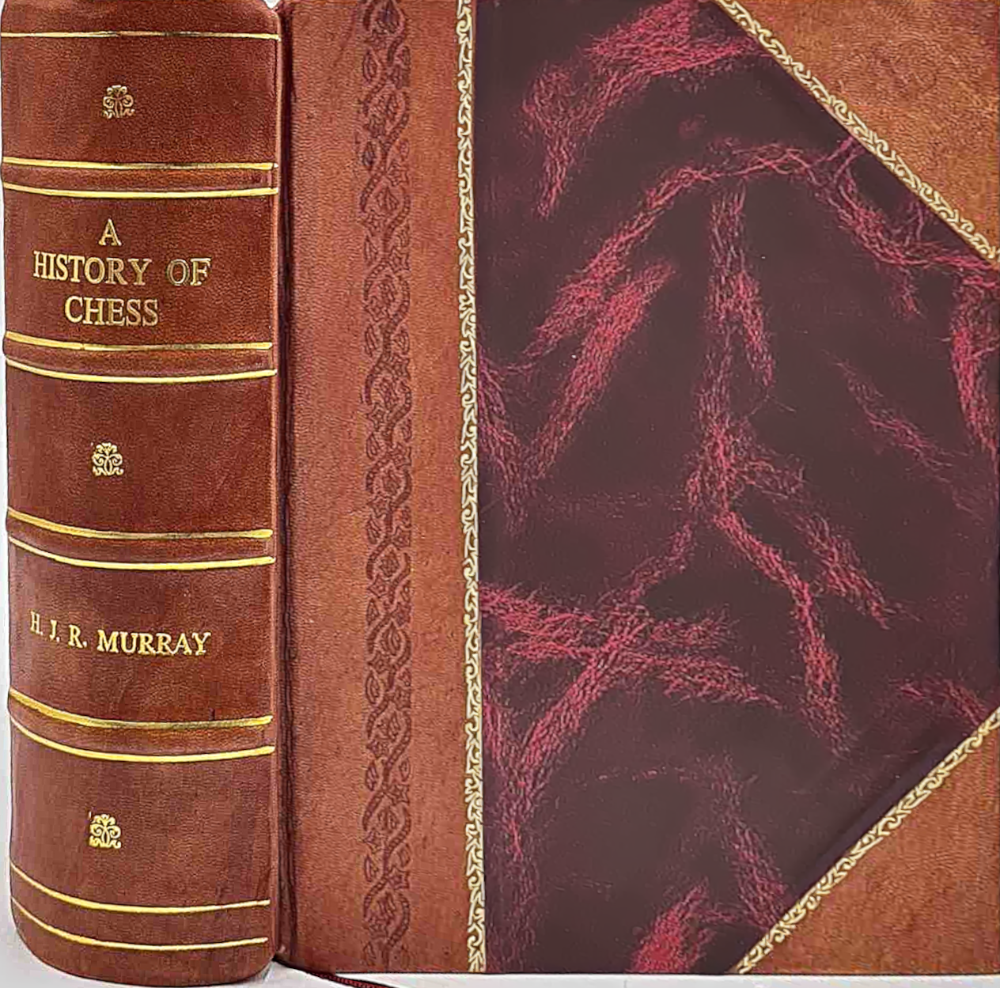
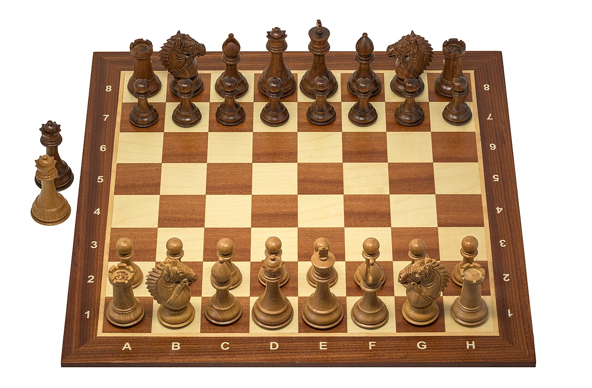
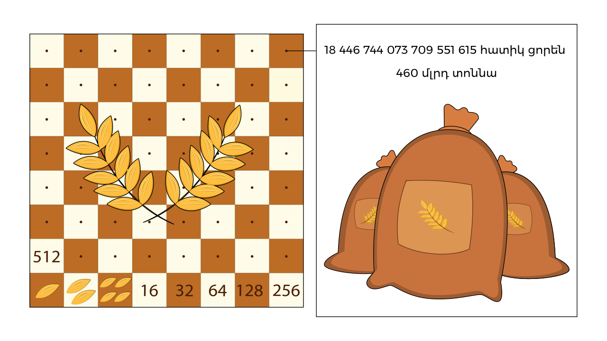

# From Ancient India to Digital Boards: A Journey Through the History of Chess

**Topic:** The History of Chess

**Generated on:** 2026-11-08 19:13:41

## Table of Contents

- [The Cradle of Chess: Ancient Origins in India](#the-cradle-of-chess-ancient-origins-in-india)
- [Eastward and Westward: The Spread Through Persia and the Arab World](#eastward-and-westward-the-spread-through-persia-and-the-arab-world)
- [The European Transformation: From Shatranj to Modern Chess](#the-european-transformation-from-shatranj-to-modern-chess)
- [The Golden Age of Chess: Masters, Tournaments, and Theory](#the-golden-age-of-chess-masters-tournaments-and-theory)
- [Chess in the Digital Era and Beyond: AI, Online Play, and the Future](#chess-in-the-digital-era-and-beyond-ai-online-play-and-the-future)

---

# The Cradle of Chess: Ancient Origins in India

The journey of chess begins in ancient India, specifically during the golden age of the Gupta Empire, around the 6th century AD, with a game known as Chaturanga. This sophisticated board game is widely recognized as the earliest direct ancestor of modern chess, laying the foundational concepts that would evolve over centuries.

Chaturanga, meaning "four divisions" (of the army), served as a strategic simulation of ancient Indian warfare. Its pieces directly mirrored the four traditional branches of the military: infantry, cavalry, elephants, and chariots, with players maneuvering to capture the opponent's "Raja" (king).

While resembling its modern descendant, Chaturanga played on an 8x8 board with distinct rules and piece movements. The "Raja" (King) moved similarly, but lacked a powerful Queen. Instead, the "Mantri" (counselor/minister) moved one square diagonally, and the "Gaja" (elephant) two squares diagonally, jumping over the first. The "Ratha" (chariot) moved like the modern rook, and the "Ashva" (horse/cavalry) like the modern knight. Pawns, or "Padati" (foot soldiers), moved one square forward, without the initial two-square option. Victory conditions also differed from modern checkmate.

While Chaturanga is firmly established as the direct ancestor, some theories propose earlier influences or precursor games from various cultures. However, concrete evidence for these pre-Chaturanga origins remains largely speculative, making the Gupta-era Chaturanga the earliest generally recognized form of the game.

### Eastward and Westward: The Spread Through Persia and the Arab World

From its ancient Indian cradle, the game of Chaturanga embarked on a transformative journey, first reaching the Sasanian Empire of Persia around the 6th century CE. Here, it was embraced by the nobility and underwent its first significant evolution, becoming *Shatranj*. This Persian adaptation saw not only a change in name but also a deep cultural integration, with the original Indian pieces receiving new, Persianized names: the *Raja* became the *Shah* (king), the *Mantri* (minister) became the *Farzin* (vizier), and the *Ratha* (chariot) became the *Rookh* (chariot or tower), among others. This transformation marked its transition from a pure battlefield simulation to a more abstract intellectual pursuit, deeply woven into Persian courtly life and literature.

Following the Arab conquest of Persia in the 7th century, Shatranj was absorbed with immense enthusiasm into the burgeoning Islamic world. Its popularity soared, becoming a favored pastime from Baghdad to Cordoba, transcending social strata. During the Islamic Golden Age, particularly from the 9th to the 12th centuries, the game experienced a profound intellectual flourishing. Scholars and polymaths developed extensive chess literature, delving into strategy, openings, and, most notably, the art of *mansubat* – intricate chess problems designed to test tactical prowess and demonstrate brilliant checkmates. This era saw the rise of legendary early Muslim chess masters, such as al-Adli and al-Suli, whose writings and games greatly advanced theoretical understanding and codified strategic principles, many of which still resonate today.

This vibrant Islamic chess culture became the primary conduit for the game's further expansion into Europe. Shatranj made its way into the continent through two main arteries: eastward via Byzantium, where it was known as *Zatrikion*, and westward through Moorish Spain, where its sophistication captivated Christian kingdoms and laid the groundwork for its eventual widespread adoption across the continent.

### The European Transformation: From Shatranj to Modern Chess

When Shatranj first arrived in medieval Europe, primarily through Moorish Spain and Byzantium, it was initially adopted with its existing rules and piece movements largely intact. For several centuries, European players engaged with a game that, while captivating, was slower and more strategically constrained than what we know today. The king, rook, and knight moved as they do now, but the queen (then called *farzin* or *vizier*) was a weak piece, moving only one square diagonally, and the bishop (then *alfil*) could only jump two squares diagonally, often requiring many moves to traverse the board. This slow pace meant games could be protracted, focusing on slow positional maneuvering rather than rapid tactical assaults.

The late 15th century, however, witnessed a dramatic shift often referred to as the "Queen's Revolution" or "Mad Queen Chess." This pivotal period, largely centered in Spain and Italy, saw the radical empowerment of the queen and bishop, fundamentally altering the game's character. The queen transformed from a modest piece into the most powerful on the board, capable of moving any number of squares orthogonally or diagonally, instantly becoming a formidable attacking force. Similarly, the bishop gained its modern, long-range diagonal movement, opening up new lines of attack and defense. These changes profoundly accelerated the game, making it far more dynamic, tactical, and exciting, encouraging aggressive play. Simultaneously, other crucial rules were introduced and gradually standardized, including castling, which allows the king to move quickly to safety and connect the rooks, and *en passant*, a special pawn capture rule that adds another layer of tactical depth.

The advent of the printing press played a crucial role in codifying these new rules and disseminating strategic knowledge across the continent. The late 15th and early 16th centuries saw the emergence of the first printed chess books and treatises, such as Luis Ramírez de Lucena's "Repetición de Amores y Arte de Ajedrez" (c. 1497) and Pedro Damiano's "Questo libro e da imparare giocare a scachi et de li partiti" (1512). These pioneering works were instrumental in standardizing the modern rules and sharing early theoretical insights, moving chess from an aristocratic pastime, often played for gambling, to a more widely recognized intellectual pursuit accessible to a broader segment of society. This transformation cemented chess's status as a game of deep strategy, profound intellectual challenge, and universal appeal, setting the stage for its global dominance.

### The Golden Age of Chess: Masters, Tournaments, and Theory

As chess spread across Europe, it gradually shed its ancient, regional variations and began to coalesce into the standardized game we recognize today. The 18th century marked the dawn of a more organized and theoretically sophisticated era, often referred to as the Golden Age of Chess. Prominent figures emerged who not only demonstrated exceptional playing skill but also profoundly influenced the game's theoretical understanding. François-André Danican Philidor, an 18th-century French master, championed the importance of pawn structure and positional play, articulating principles that remain foundational. A century later, Paul Morphy, an American prodigy, captivated the chess world with his brilliant attacking style and intuitive understanding of development, demonstrating the power of rapid piece activation. Howard Staunton, an English master, not only excelled as a player but also played a crucial role in organizing early tournaments and popularizing a distinctive set design that bears his name.

This growing interest in competitive play culminated in a landmark event: the first international chess tournament held in London in 1851. This gathering of the world's leading players set a precedent for modern tournament play, establishing formats and rules that would shape future competitions. It was a pivotal moment, transforming chess from a series of individual matches into a globally recognized competitive sport. The success of London 1851 paved the way for the establishment of the official World Chess Championship, a title that would define the pinnacle of chess achievement. Wilhelm Steinitz, an Austrian-born American player, became the first undisputed World Champion in 1886, ushering in an era where the quest for this prestigious title would drive innovation and competition.

Hand-in-hand with this organizational growth was the rapid development and refinement of chess theory. Masters meticulously studied openings, devising intricate variations and strategies to gain early advantages. Middle-game play evolved with deeper understanding of tactical motifs, strategic planning, and positional nuances. End-game techniques, once considered an afterthought, became a specialized field of study, with comprehensive guides on pawn endings, rook endings, and other complex scenarios. The professionalization of chess was further bolstered by the proliferation of chess clubs, which served as vital hubs for learning and competition. Dedicated chess journals and publications emerged, disseminating game analyses, tournament reports, and theoretical articles, popularizing the game and fostering a vibrant global community of players and enthusiasts.

### Chess in the Digital Era and Beyond: AI, Online Play, and the Future

The late 20th century ushered in a revolutionary transformation for chess, as technology began to reshape every aspect of the game. The advent of chess computers and artificial intelligence (AI) fundamentally altered the landscape. From early programs that could challenge amateur players, AI rapidly evolved, culminating in a watershed moment in 1997 when IBM's Deep Blue famously defeated reigning World Champion Garry Kasparov in a match. This event was not merely a technological triumph but a profound shift, demonstrating the immense analytical power of machines and forcing humanity to reconsider its unique intellectual dominance over the board.

Following this, the rise and impact of online chess platforms became undeniable. Websites like Chess.com and Lichess democratized the game, offering unprecedented accessibility to players worldwide. Suddenly, anyone with an internet connection could play against opponents of any skill level, participate in tournaments, and access vast libraries of chess content. This global connectivity dramatically increased participation, breaking down geographical barriers and fostering a truly international chess community.

AI's role quickly transitioned from just an opponent to an indispensable tool. Today, AI-powered engines have transformed chess training, analysis, and preparation for players of all levels. Grandmasters use them to uncover novel opening ideas and dissect complex positions, while casual players leverage them to review their games, identify weaknesses, and learn from their mistakes. This symbiotic relationship between human and machine has pushed the boundaries of chess understanding further than ever before.

Beyond individual improvement, the digital era has propelled the growth of chess as an esport. Online tournaments, often featuring substantial prize pools, attract millions of viewers globally. Streaming platforms have become mainstream, with top players and content creators engaging vast audiences through live commentary, analysis, and entertainment. This blend of competitive gaming and interactive media has introduced chess to new generations, ensuring its continued cultural relevance. Despite the profound technological shifts, the timeless appeal of chess — its blend of logic, creativity, and struggle — endures, proving its continued relevance in a rapidly evolving digital world.

## Images

**File:A History of Chess, cover.png** — H. J. R. Murray.
License: [Public domain]().
[Original image on Wikimedia Commons](https://commons.wikimedia.org/wiki/File:A_History_of_Chess,_cover.png).

**File:Chess game Staunton No. 6 perfil view 8.jpg** — Wilfredor.
License: [CC0](http://creativecommons.org/publicdomain/zero/1.0/deed.en).
[Original image on Wikimedia Commons](https://commons.wikimedia.org/wiki/File:Chess_game_Staunton_No._6_perfil_view_8.jpg).

**File:Chess history illustration (HY).svg** — DVardanyan.
License: [CC BY-SA 4.0](https://creativecommons.org/licenses/by-sa/4.0).
[Original image on Wikimedia Commons](https://commons.wikimedia.org/wiki/File:Chess_history_illustration_(HY).svg).

---

## Research Sources

No source links were returned by the research agent.
